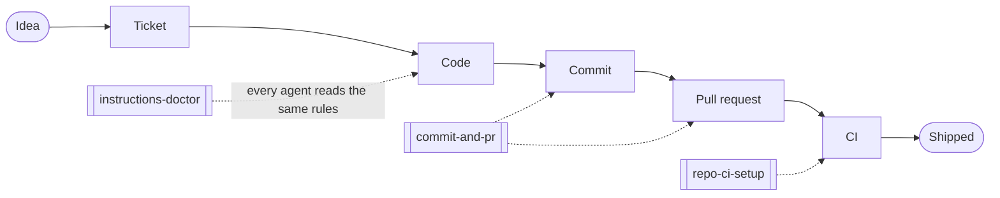

# agent-standards

We are building a software factory: engineers and AI agents shipping value
to customers faster, with less rework. That only works when the shared
parts of the work come out the same whoever asked and whichever agent did
it. This repo holds those parts as skills, one copy each, serving Claude
Code, Codex and GitHub Copilot.

## Where the skills sit



Commits, PRs and CI are the covered stages: used every day, consumed by
everyone, with conventions nobody has to invent. Your tone, tools and
personal workflows stay yours.

## Install in two minutes

Claude Code:

```text
/plugin marketplace add hungovercoders/agent-standards
/plugin install agent-standards@hungovercoders
```

Codex, Copilot, or Claude Code without the plugin:

```bash
git clone https://github.com/hungovercoders/agent-standards
cd agent-standards
mise install   # then activate mise in your shell; or scripts/bootstrap.sh
task install:skills AGENTS=codex,copilot   # drop AGENTS= if you skip the plugin
```

## Then try it

| Say to your agent | What happens |
|---|---|
| "check my agent setup" | the doctor finds instructions that compete with the shared skills |
| "commit this" | a Conventional Commit linked to your Linear issue, pushed |
| "open a PR" | a draft PR with What, Why, How to test and Risks |
| "set up CI for this repo" | one `ci` job that runs on drafts and gates the merge |

Everything else lives in [docs/](docs/README.md): why, the skill catalog,
per-tool install details, skills from outside this repo such as
Cloudflare's, and the GitHub org setup.

## Contribute

Everything here reaches every engineer on their next update, so read
[CONTRIBUTING.md](CONTRIBUTING.md) before changing a skill. Fixes need no
ceremony; new rules need a decision record. `mise install && task setup`
installs the tools and hooks, and `task --list` shows every command.
